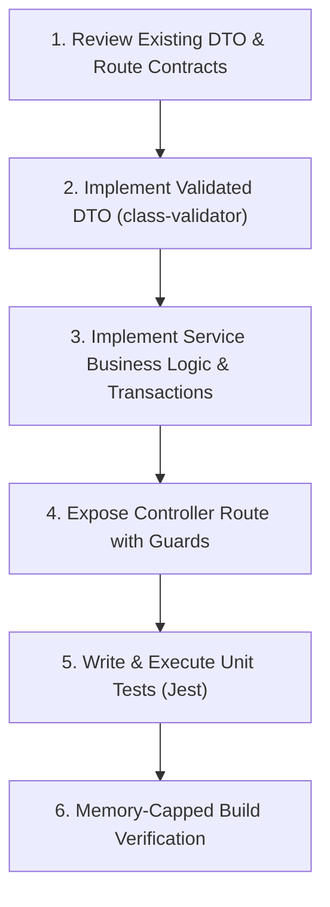

# Ryo Academy Backend Feature Development

This skill governs the addition and modification of backend services, controllers, DTOs, and repositories in `ryo-academy-be`.

## 1. Scope & Boundaries

- **In Scope:** NestJS module composition, controller endpoints, service business logic, DTO validation, Prisma interactive transactions, and unit/integration tests.
- **Out of Scope:** Inventing unsupported route contracts, unapproved schema migrations, or frontend UI components.
- **Strict Prohibition:** Never invent routes, DTO fields, or permissions not supported by domain contracts. Never connect to Neon or unverified shared databases.

---

## 2. Context References

- Backend Conventions: [backend-conventions.md](file:///home/qwerty/Qwerty_WorkSpace/ProjWorks/Poo%20anna/Ryo%20Academy/Backend/docs/agent-context/backend-conventions.md)
- System Architecture: [architecture.md](file:///home/qwerty/Qwerty_WorkSpace/ProjWorks/Poo%20anna/Ryo%20Academy/Backend/docs/agent-context/architecture.md)
- Domain Rules: [domain-business-rules.md](file:///home/qwerty/Qwerty_WorkSpace/ProjWorks/Poo%20anna/Ryo%20Academy/Backend/docs/agent-context/domain-business-rules.md)
- Financial Invariants: [financial-module-rules.md](file:///home/qwerty/Qwerty_WorkSpace/ProjWorks/Poo%20anna/Ryo%20Academy/Backend/docs/agent-context/financial-module-rules.md)
- Testing Standards: [testing-and-quality.md](file:///home/qwerty/Qwerty_WorkSpace/ProjWorks/Poo%20anna/Ryo%20Academy/Backend/docs/agent-context/testing-and-quality.md)

---

## 3. Implementation Workflow



### Step 1: Contract & DTO Design
- Create request DTOs in the module's `dto/` directory.
- Apply explicit validation decorators (`@IsString()`, `@IsUUID()`, `@IsNumber()`, `@IsOptional()`).
- Use `@Type(() => SubDto)` when parsing nested arrays or objects.
- Ensure all inputs conform to NestJS `ValidationPipe` whitelist rules.

### Step 2: Service Logic & Transaction Boundaries
- Encapsulate business logic in domain services.
- Multi-row mutations or financial updates must execute inside a transaction:
  ```typescript
  return await this.prisma.$transaction(async (tx) => {
    // Perform operations via tx
    // If financial, emit immutable FinancialLog
  });
  ```
- Multi-tenancy check: Always filter queries by `schoolId`.

### Step 3: Controller & Guard Composition
- Decorate controller routes with appropriate HTTP methods (`@Get()`, `@Post()`, `@Put()`, `@Delete()`).
- Attach authentication and context guards (`@UseGuards(JwtAuthGuard, SchoolContextGuard, RolesGuard)`).
- Never return sensitive data (hashes, internal tokens) in responses.

### Step 4: Verification & Build
From `ryo-academy-be/`:

```bash
# 1. Run unit test suite for the modified service
npx jest src/admission/admission-fee-log/admission.service.spec.ts

# 2. Run full backend build with memory constraint
NODE_OPTIONS=--max-old-space-size=512 prisma generate && NODE_OPTIONS=--max-old-space-size=512 nest build
```

---

## 4. Approval Gates for Risky Operations

> [!CAUTION]
> **Database-backed Integration Testing Gate:**
> Running integration tests that write to PostgreSQL requires:
> 1. Explicit verification that `DATABASE_URL` points to an approved disposable local QA database.
> 2. Idempotent fixture setup with guaranteed teardown in `afterAll`.
> 3. Verification of zero residue left in the database.
