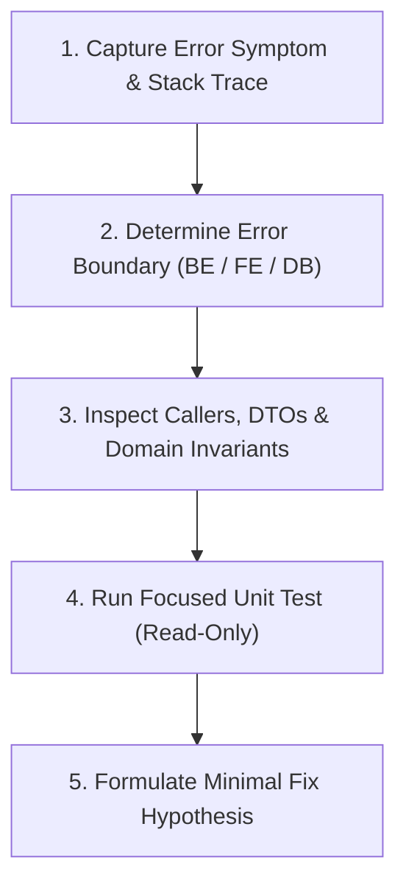

# Ryo Academy Bug Investigation

This skill guides root-cause investigation for defects in the Ryo Academy codebase across NestJS, Prisma, PostgreSQL, React, and Vite.

## 1. Scope & Boundaries

- **In Scope:** Read-only inspection of source code, error logs, Prisma models, test assertions, and API error payloads; running non-mutating unit tests; formulating targeted hypotheses.
- **Out of Scope:** Making speculative code edits; running destructive migration rollbacks; modifying live/shared databases.
- **Risky Operation Gate:** If reproduction requires database writes or running integration tests, verify that `DATABASE_URL` targets an approved disposable local QA database. **Never connect to Neon or unverified remote databases.**

---

## 2. Context References

- Architecture Overview: [architecture.md](file:///home/qwerty/Qwerty_WorkSpace/ProjWorks/Poo%20anna/Ryo%20Academy/Backend/docs/agent-context/architecture.md)
- Domain Rules: [domain-business-rules.md](file:///home/qwerty/Qwerty_WorkSpace/ProjWorks/Poo%20anna/Ryo%20Academy/Backend/docs/agent-context/domain-business-rules.md)
- Financial Invariants: [financial-module-rules.md](file:///home/qwerty/Qwerty_WorkSpace/ProjWorks/Poo%20anna/Ryo%20Academy/Backend/docs/agent-context/financial-module-rules.md)
- Known Constraints: [known-technical-constraints.md](file:///home/qwerty/Qwerty_WorkSpace/ProjWorks/Poo%20anna/Ryo%20Academy/Backend/docs/agent-context/known-technical-constraints.md)

---

## 3. Investigation Workflow



### Step 1: Capture Symptom & Error Boundary
- Inspect the stack trace, error code, or HTTP status.
- Determine if the failure originates in:
  - **Frontend:** API adapter (`src/lib/*-api.ts`), React Query key mismatch, component render cycle, or form validation (`Zod`).
  - **Backend Controller:** Input payload rejected by `ValidationPipe` (`class-validator`), unauthorized by `SchoolContextGuard` or `RolesGuard`.
  - **Backend Service:** Domain validation failure (e.g. invalid status transition in `AdmissionService`, interval partition mismatch in `AdmissionInstallmentScheduleService`).
  - **Database:** Prisma relational constraint violation (e.g., P2002 unique constraint, P2003 foreign key violation on `onDelete: Restrict`).

### Step 2: Source Code & Lineage Inspection
- For financial bugs, cross-reference against [financial-module-rules.md](file:///home/qwerty/Qwerty_WorkSpace/ProjWorks/Poo%20anna/Ryo%20Academy/Backend/docs/agent-context/financial-module-rules.md):
  - Check whether monetary conservation was violated ($\sum \text{installments} \neq \text{netAmount}$).
  - Verify whether installment DAG lineage leaves partition the parent interval without gaps.
- For admissions bugs, check [domain-business-rules.md](file:///home/qwerty/Qwerty_WorkSpace/ProjWorks/Poo%20anna/Ryo%20Academy/Backend/docs/agent-context/domain-business-rules.md):
  - Note that admission cancellation preconditions are currently unresolved; do not assume cancellation is invalid purely because of status.

### Step 3: Focused Test Reproduction (Zero-Residue)
Run the specific unit test without modifying source:

```bash
# For backend issues:
cd ryo-academy-be
npx jest path/to/failing.spec.ts

# For frontend issues:
cd ryo-academy-fe
npx vitest run path/to/failing.test.tsx
```

---

## 4. Deliverable & Resolution Plan

Document the investigation findings:
1. **Exact Root Cause:** Name the file, function, and logical invariant that broke.
2. **Impacted Boundaries:** List affected controllers, DTOs, or frontend adapters.
3. **Smallest Complete Fix:** Detail the minimal code change required.
4. **Verification Plan:** State the exact test command to prove resolution.
