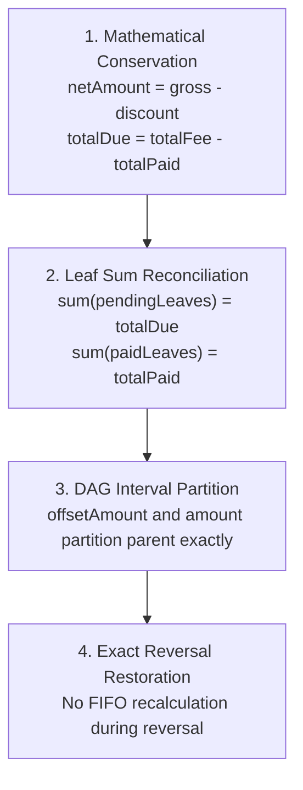

# Ryo Academy Financial Integrity Testing

This skill governs the testing and validation of the financial module's mathematical invariants, DAG installment trees, and reversal coordinates.

## 1. Scope & Boundaries

- **In Scope:** Validating mathematical conservation equations, DAG transfer edges, leaf split interval integrity, exact reversal restoration, advisory locking `55432001`, and historical offset backfills.
- **Out of Scope:** Inventing new financial formulas, modifying ledger tables directly without transaction models, or altering historical financial records.
- **Strict Database Boundary:** All financial tests and backfill verifications must run against an **approved disposable local QA database**. Neon and remote databases are strictly prohibited.

---

## 2. Context References

- Financial Specification: [docs/architecture/financial-module-v1.md](file:///home/qwerty/Qwerty_WorkSpace/ProjWorks/Poo%20anna/Ryo%20Academy/Backend/docs/architecture/financial-module-v1.md)
- Financial Runbook: [docs/operations/financial-module-v1-runbook.md](file:///home/qwerty/Qwerty_WorkSpace/ProjWorks/Poo%20anna/Ryo%20Academy/Backend/docs/operations/financial-module-v1-runbook.md)
- Financial Invariants: [financial-module-rules.md](file:///home/qwerty/Qwerty_WorkSpace/ProjWorks/Poo%20anna/Ryo%20Academy/Backend/docs/agent-context/financial-module-rules.md)
- Known Constraints: [known-technical-constraints.md](file:///home/qwerty/Qwerty_WorkSpace/ProjWorks/Poo%20anna/Ryo%20Academy/Backend/docs/agent-context/known-technical-constraints.md)

---

## 3. Verification Checklist & Invariants



### Invariant 1: Mathematical Conservation
Verify that every financial test asserts:
$$\text{totalFeeAmount} \equiv \text{netAmount} \equiv \text{grossAmount} - \text{discountAmount}$$
$$\text{totalDueAmount} \equiv \text{totalFeeAmount} - \text{totalPaidAmount}$$
Zero floating-point rounding or silent clamping is permitted.

### Invariant 2: Leaf Sum Reconciliation
Assert that active leaves in `AdmissionInstallment` reconcile:
- Sum of active pending leaves equals `totalDueAmount`.
- Sum of active settled leaves equals `totalPaidAmount`.

### Invariant 3: DAG Interval & Offset Partitioning
- When a payment partially settles an installment, confirm:
  - Parent status flips to `SUPERSEDED` with `supersededAt = now()`.
  - Exactly two child leaves are generated with matching `sequenceNumber`.
  - Child offsets partition the parent interval:
    $$\text{Child 1: } [\text{parent.offsetAmount}, \text{parent.offsetAmount} + \text{allocated}]$$
    $$\text{Child 2: } [\text{parent.offsetAmount} + \text{allocated}, \text{parent.offsetAmount} + \text{parent.amount}]$$

### Invariant 4: Exact Reversal Restoration
- Reversals must restore the pre-payment DAG state directly from `FeePaymentInstallmentAllocation`.
- The system must **never** rerun FIFO allocation during reversal.

---

## 4. Test Execution & Backfill Commands

From `ryo-academy-be/`:

```bash
# 1. Run financial unit tests
npx jest src/student/payment-reversal.service.spec.ts
npx jest src/admission/installment/v0-installment-schedule.spec.ts

# 2. Run historical offset backfill runner (approved local QA DB only!)
npm run backfill:offsets
```

---

## 5. Approval Gates for Risky Operations

> [!CAUTION]
> **Advisory Lock & Backfill Gate:**
> Executing `npm run backfill:offsets` or running financial migrations requires:
> 1. Verified PostgreSQL advisory lock `55432001` acquired on a direct connection (`DIRECT_DATABASE_URL`).
> 2. Zero concurrent write traffic in progress.
> 3. Zero unresolved NULL offsets remaining after backfill.
