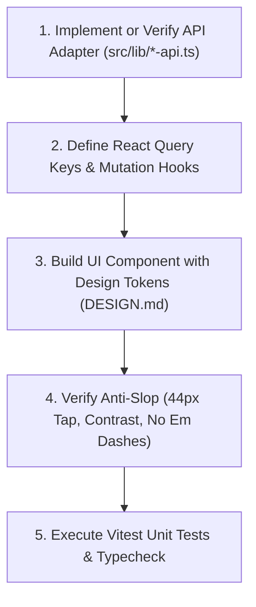

# Ryo Academy Frontend Feature Development

This skill governs the development of user interfaces, API client adapters, and React Query data hooks in `ryo-academy-fe`.

## 1. Scope & Boundaries

- **In Scope:** React components, routed page views, React Query hooks, centralized API client adapters (`src/lib/*-api.ts`), form validation (Zod), and Vitest test suites.
- **Out of Scope:** Inventing unsupported backend routes, breaking mock fallbacks for unmigrated modules, or making backend schema changes.
- **Strict Scope Freeze:** **Timetable frontend work is strictly out of scope** until V0 browser QA is explicitly signed off.

---

## 2. Context References

- Frontend Conventions: [frontend-conventions.md](file:///home/qwerty/Qwerty_WorkSpace/ProjWorks/Poo%20anna/Ryo%20Academy/Backend/docs/agent-context/frontend-conventions.md)
- Design Identity & Visual Contract: [DESIGN.md](file:///home/qwerty/Qwerty_WorkSpace/ProjWorks/Poo%20anna/Ryo%20Academy/Backend/DESIGN.md)
- Anti-Slop Changes: [anti-slop-changes.md](file:///home/qwerty/Qwerty_WorkSpace/ProjWorks/Poo%20anna/Ryo%20Academy/Backend/ryo-academy-fe/docs/anti-slop-changes.md)
- Module Tracker: [module-integration-tracker.md](file:///home/qwerty/Qwerty_WorkSpace/ProjWorks/Poo%20anna/Ryo%20Academy/Backend/docs/module-integration-tracker.md)

---

## 3. Implementation Workflow



### Step 1: API Adapter & Error Normalization
- Create or update the module API adapter in `src/lib/<module>-api.ts`.
- Use the centralized `apiClient`:
  ```typescript
  import { apiClient } from "./api-client";

  export async function getStudentFees(studentId: string): Promise<StudentFeesDto> {
    return apiClient.get<StudentFeesDto>(`/students/${studentId}/fees`);
  }
  ```
- Catch and display errors via normalized `ApiError`.

### Step 2: React Query Integration
- Define hierarchical query keys in the adapter or hook file.
- Invalidate stale queries upon mutation success:
  ```typescript
  const queryClient = useQueryClient();
  const mutation = useMutation({
    mutationFn: createPayment,
    onSuccess: () => queryClient.invalidateQueries({ queryKey: ["students", studentId, "fees"] }),
  });
  ```

### Step 3: Component & Design Token Standards
- Adhere strictly to [DESIGN.md](file:///home/qwerty/Qwerty_WorkSpace/ProjWorks/Poo%20anna/Ryo%20Academy/Backend/DESIGN.md):
  - Typography: `font-sans` ("DM Sans") for body, `font-serif` ("Fraunces") for headers, `font-mono` for currency figures.
  - Colors: Use semantic CSS custom properties (`bg-card`, `text-card-foreground`, `border-border`, `text-primary`).
  - Radii: `rounded-lg` for containers, `rounded-sm` for badges.

### Step 4: Anti-Slop & Accessibility Hygiene
- **Zero Em Dashes:** Never use `—` in table fallbacks or labels. Use `-` instead.
- **Tap Targets:** Interactive controls must guarantee 44px min-size on touch screens (`min-h-[44px] min-w-[44px] sm:min-h-0 sm:min-w-0`).
- **Contrast Check:** Inactive rows must use `bg-muted/30` with `text-muted-foreground` (never `opacity-60`).
- **Keyboard Focus:** Ensure `focus-visible:ring-1 focus-visible:ring-ring` is active.

### Step 5: Verification Commands
From `ryo-academy-fe/`:

```bash
# 1. Verify TypeScript types
npm run typecheck

# 2. Run unit tests
npm run test

# 3. Verify production build
npm run build
```

---

## 4. Approval Gates for Risky Operations

> [!CAUTION]
> **Browser QA Gate:**
> Executing automated browser journeys (Playwright) against a live backend requires:
> 1. Explicit repository owner authorization.
> 2. Verified backend running against an approved disposable local QA database.
> 3. Zero sensitive credentials hardcoded in tests.
