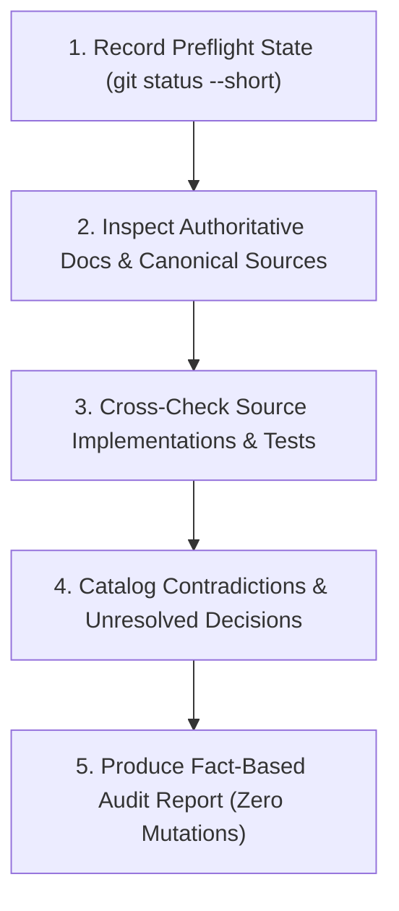

# Ryo Academy Read-Only Auditing

This skill governs read-only investigations, security reviews, architecture assessments, and pre-implementation audits across Ryo Academy.

## 1. Scope & Boundaries

- **In Scope:** Read-only inspection of source files, documentation, Git history, package dependencies, and test files; running non-mutating status and diagnostic commands.
- **Out of Scope:** Creating, editing, or deleting files; staging or committing changes; running migrations or seeds; altering database contents.
- **Strict Rule:** **Zero mutations allowed.** If a command would write to disk or database, it must not be run.

---

## 2. Context References

- Monorepo Overview: [project-overview.md](file:///home/qwerty/Qwerty_WorkSpace/ProjWorks/Poo%20anna/Ryo%20Academy/Backend/docs/agent-context/project-overview.md)
- Testing & Quality: [testing-and-quality.md](file:///home/qwerty/Qwerty_WorkSpace/ProjWorks/Poo%20anna/Ryo%20Academy/Backend/docs/agent-context/testing-and-quality.md)
- Migration Changelog: [frontend-backend-migration-changelog.md](file:///home/qwerty/Qwerty_WorkSpace/ProjWorks/Poo%20anna/Ryo%20Academy/Backend/ryo-academy-fe/docs/frontend-backend-migration-changelog.md)
- Module Tracker: [module-integration-tracker.md](file:///home/qwerty/Qwerty_WorkSpace/ProjWorks/Poo%20anna/Ryo%20Academy/Backend/docs/module-integration-tracker.md)

---

## 3. Auditing Workflow



### Step 1: Preflight Verification
- Record Git status and active branch:
  ```bash
  git status --short
  git rev-parse HEAD
  ```
- Confirm no untracked modifications are introduced during the audit.

### Step 2: Source Code Cross-Checking
- Compare claimed features against actual source:
  - Check controller routes and DTO validation rules.
  - Inspect Prisma schemas and foreign key deletion behaviors (`onDelete: Restrict`).
  - Verify frontend API client adapters and fallback paths in `src/lib/mock-erp.ts`.
- Separate verified source facts from unverified claims or future aspirations.

### Step 3: Flagging Contradictions & Unresolved Decisions
- If conflicting business rules exist (e.g. status transition guards vs open cancellation), report them as **unresolved questions**. Do not make speculative assumptions.

---

## 4. Deliverable Standards

Audit reports must include:
1. **Source Document Inventory:** Exact paths of all inspected files.
2. **Verified Facts:** Concrete evidence backed by line numbers and function names.
3. **Unresolved Decisions:** Explicitly highlighted questions requiring human product decisions.
4. **Git Baseline Integrity:** Confirmation that `git status` matches preflight exactly with zero unwanted mutations.
