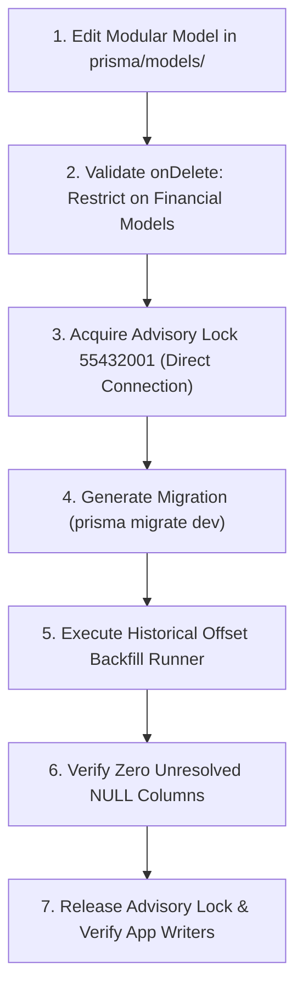

# Ryo Academy Schema Migration & Maintenance

This skill governs Prisma database schema modifications, migration generation, advisory locking, and backfill execution in `ryo-academy-be`.

## 1. Scope & Boundaries

- **In Scope:** Editing modular Prisma models in `prisma/models/`, generating SQL migrations, checking foreign key deletion rules, acquiring advisory lock `55432001`, and executing data backfills.
- **Out of Scope:** Making direct out-of-band schema edits in production, using unverified cloud databases (Neon), or running unapproved migrations.
- **Strict Database Rule:** Migrations and backfill runners may execute **only on an approved disposable local QA database**.

---

## 2. Context References

- Financial Specification: [docs/architecture/financial-module-v1.md](file:///home/qwerty/Qwerty_WorkSpace/ProjWorks/Poo%20anna/Ryo%20Academy/Backend/docs/architecture/financial-module-v1.md)
- Financial Runbook: [docs/operations/financial-module-v1-runbook.md](file:///home/qwerty/Qwerty_WorkSpace/ProjWorks/Poo%20anna/Ryo%20Academy/Backend/docs/operations/financial-module-v1-runbook.md)
- Backend Conventions: [backend-conventions.md](file:///home/qwerty/Qwerty_WorkSpace/ProjWorks/Poo%20anna/Ryo%20Academy/Backend/docs/agent-context/backend-conventions.md)
- Known Constraints: [known-technical-constraints.md](file:///home/qwerty/Qwerty_WorkSpace/ProjWorks/Poo%20anna/Ryo%20Academy/Backend/docs/agent-context/known-technical-constraints.md)

---

## 3. Migration & Staged Deployment Workflow



### Step 1: Modular Model Editing
- Prisma models are located under `ryo-academy-be/prisma/models/`:
  - `academic/`, `admission_fees/`, `attendance/`, `finance/`, `identity/`.
- Ensure all parent financial relationships enforce `onDelete: Restrict`.
- Re-generate Prisma client with memory limits:
  ```bash
  NODE_OPTIONS=--max-old-space-size=512 prisma generate
  ```

### Step 2: Advisory Locking & Maintenance Window
For financial schema alterations:
1. Connect via direct unpooled database connection (`DIRECT_DATABASE_URL`).
2. Acquire advisory lock:
   ```sql
   SELECT pg_advisory_lock(55432001);
   ```
3. Freeze financial write traffic during the migration window.

### Step 3: Migration Execution & Backfills
- Generate and apply migration:
  ```bash
  npx prisma migrate dev --name <descriptive_migration_name>
  ```
- If adding interval offsets or financial coordinates, execute the backfill runner:
  ```bash
  npm run backfill:offsets
  ```
- Confirm zero NULL values remain in required offset columns before dropping database defaults.

### Step 4: Lock Release & Verification
- Release the advisory lock:
  ```sql
  SELECT pg_advisory_unlock(55432001);
  ```

---

## 4. Approval Gates for Risky Operations

> [!CAUTION]
> **Schema Migration & Backfill Gate:**
> Applying migrations or running `npm run backfill:offsets` requires:
> 1. Explicit owner authorization.
> 2. Verified target is an approved disposable local QA database (Neon strictly prohibited).
> 3. Zero uncommitted changes outside the intended migration.
