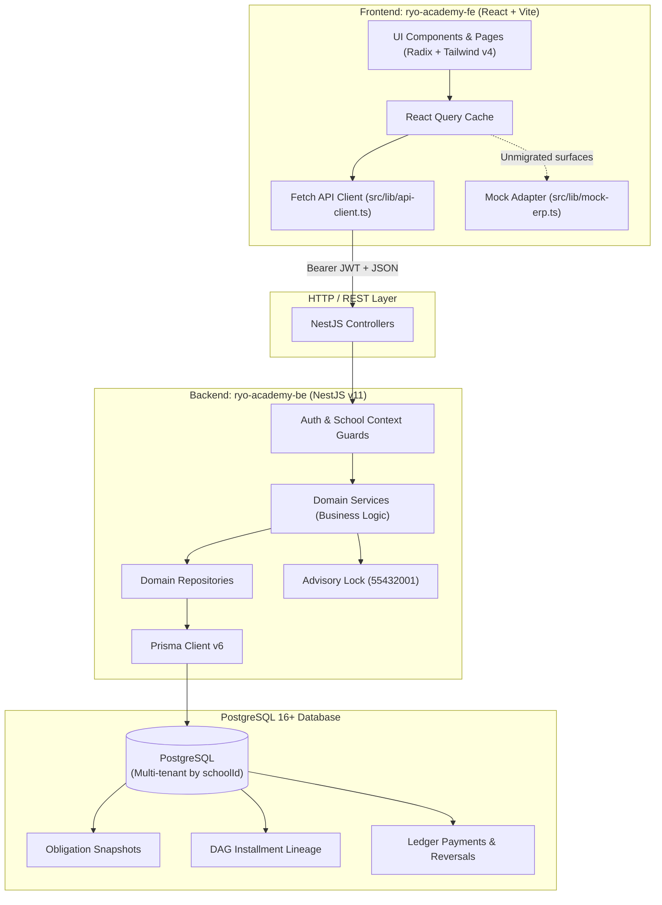

# Ryo Academy — System Architecture

> **Context Document**  
> **Status:** Authoritative  
> **Audience:** Human Engineers and AI Agents  
> **Canonical Path:** `docs/agent-context/architecture.md`

---

## 1. Architectural Topology

Ryo Academy is structured as a client-server web architecture with strict separation of concerns:



---

## 2. Multi-Tenant School Context Isolation

1. **Isolation Model:** Multi-tenancy is enforced logically at the row level via `schoolId`.
2. **Context Resolution:** 
   - HTTP requests supply tenant context via authenticated JWT tokens or school headers.
   - `SchoolContextGuard` and `RolesGuard` validate tenant membership before execution enters service methods.
3. **Query Scoping:** 
   - All Prisma database queries touching tenant-owned entities (Admissions, Students, Classes, Fees, Attendance) must explicitly include `schoolId` in the `where` clause.
   - Cross-school reads or writes are strictly forbidden and constitute security vulnerabilities.

---

## 3. Backend Layout & Layering (`ryo-academy-be`)

Backend code is organized modularly by business domain in `src/`:

```text
src/
├── academic/                 # Academic Years, Programs, Classes, Sections, Subjects
├── admission/                # Admissions, Fee Structures, Concessions, Installments
│   ├── admission-fee-log/    # Admission lifecycle and fee snapshots
│   ├── fee-component/        # Master fee components
│   ├── fee-concession/       # Concession categories and allocations
│   ├── fee-structure/        # Base fee structures and term configurations
│   └── installment/          # Installment templates and schedules
├── attendance/               # Daily attendance records and session tracking
├── student/                  # Student profiles, fee payment collection, reversals
├── auth/                     # JWT authentication, Argon2 hashing, guards
└── database/                 # Prisma service, seeds, and migrations
```

### Layer Responsibilities
- **Controllers:** Handle HTTP routing, input serialization, and DTO validation via `ValidationPipe`. Never contain raw database queries.
- **Services:** Encapsulate business invariants, coordinate multi-entity operations, and define transaction boundaries (`prisma.$transaction`).
- **Repositories:** Isolate complex database access and custom query building.
- **DTOs:** Strong typing and validation using `class-validator` and `class-transformer`.

---

## 4. Frontend Architecture & Adapter Boundary (`ryo-academy-fe`)

```text
src/
├── components/               # Reusable UI primitives and layout shells
├── hooks/                    # Custom React hooks
├── lib/                      # Infrastructure, API adapters, and utilities
│   ├── api-client.ts         # Centralized Fetch wrapper with auth handling
│   ├── mock-erp.ts           # Transitional mock data store for unmigrated modules
│   └── *-api.ts              # Domain-specific API client adapters
└── pages/                    # Domain page views and routed screens
```

### Hybrid Migration Architecture
- **Real-API Integration:** Fully migrated modules (Academic Years, Programs, Classes, Sections, Subjects, Fee Structures, Admissions) call real backend endpoints through dedicated adapters in `src/lib/*-api.ts`.
- **Transitional Mocks:** Unmigrated modules (Timetable, portions of Attendance, Dashboard) remain safely routed to `mock-erp.ts`.
- **Rule of Isolation:** Modifying a migrated module must never inadvertently break or alter the mock fallback behavior of unmigrated modules.

---

## 5. Cross-Cutting Invariants

1. **Database Schema Multi-File Layout:** Prisma schema models are partitioned across `prisma/models/` (`academic`, `admission_fees`, `attendance`, `finance`, `identity`). Modifications must respect modular file placement.
2. **Deterministic Error Handling:** Backend services return structured error codes mapped to HTTP status codes. The frontend normalizes these into standard `ApiError` instances containing readable messages and validation fields.
3. **Database Transaction Boundaries:** Any write operation involving multiple entities or monetary balance updates must be wrapped in an explicit ACID database transaction.
