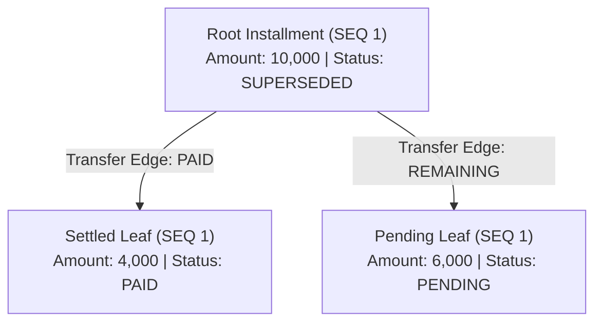

# Ryo Academy — Financial Module Rules & Invariants

> **Context Document**  
> **Status:** Authoritative (Progressive Disclosure Companion to `financial-module-v1.md`)  
> **Audience:** Human Engineers and AI Agents  
> **Canonical Specification:** [docs/architecture/financial-module-v1.md](file:///home/qwerty/Qwerty_WorkSpace/ProjWorks/Poo%20anna/Ryo%20Academy/Backend/docs/architecture/financial-module-v1.md)  
> **Operational Runbook:** [docs/operations/financial-module-v1-runbook.md](file:///home/qwerty/Qwerty_WorkSpace/ProjWorks/Poo%20anna/Ryo%20Academy/Backend/docs/operations/financial-module-v1-runbook.md)

---

## 1. Executive Summary & Ledger Principles

The Financial Module V1 provides a ledger-grade, double-entry-auditable financial system. It manages fee obligation snapshots, installment schedules, concession workflows, payment collection, and payment reversals. 

All monetary values are integer-safe representations. Floating-point arithmetic, silent clamping, and balance guessing are **strictly prohibited**.

---

## 2. Core Mathematical Invariants

At every level of the financial hierarchy, the following mathematical conservation equalities must hold true at all times:

1. **Header Conservation:**
   $$\text{netAmount} \equiv \text{grossAmount} - \text{discountAmount}$$
   $$\text{totalFeeAmount} \equiv \text{netAmount}$$
   $$\text{totalDueAmount} \equiv \text{totalFeeAmount} - \text{totalPaidAmount}$$

2. **Lineage Leaf Reconciliation:**
   $$\sum_{i} \text{activePendingLeaves}_i \equiv \text{totalDueAmount}$$
   $$\sum_{j} \text{activePaidLeaves}_j \equiv \text{totalPaidAmount}$$

3. **Schedule Reconciliation:**
   $$\sum_{k} \text{rootInstallments}_k \equiv \text{schedule.totalAmount} \equiv \text{header.netAmount}$$

4. **Zero-Drift Rule:**
   If any balance check fails, the transaction must immediately throw an unhandled domain exception and roll back. Clamping values to `0` or adjusting rounding errors silently is prohibited.

---

## 3. Directed Acyclic Graph (DAG) Installment Lineage

Installments are modeled not as flat rows, but as directed acyclic trees within sequence boundaries:



### Lineage Rules
- **Partial Payment Splitting:** A partial payment against an active installment does not mutate the existing row's monetary amount. Instead, it marks the parent installment as `SUPERSEDED` and creates two child leaves connected via `InstallmentLineageTransferEdge`:
  1. A `PAID` settled leaf reflecting the allocated amount.
  2. A `PENDING` active leaf reflecting the remaining unpaid obligation.
- **Interval Offset Partitioning:** Every installment tracks its exact coordinate within the schedule via `[offsetAmount, offsetAmount + amount]`. Leaf splits must partition the parent's interval exactly without gaps or overlaps.

---

## 4. Payment Reversal Rules

1. **Exact Coordinate Restoration:**
   - Reversing a payment (`PaymentReversalEvent`) does **not** rerun FIFO allocation or redistribute funds.
   - It references the exact `FeePaymentInstallmentAllocation` records and reverses the specific DAG edges.
   - The original pending and settled states are restored to their precise pre-payment coordinates.
2. **Partial Reversal Prohibition:**
   - In Financial Module V1, reversals are atomic and full per payment transaction. Partial payment reversals are prohibited.
3. **Monotonic Counter Mutation Only:**
   - Financial transactions are append-only. Mutation is permitted exclusively on explicitly approved monotonic counters (`FeePaymentInstallmentAllocation.reversedAmount`, `FeePaymentHeader.totalPaidAmount`, `FeePaymentHeader.totalDueAmount`) inside verified database transactions.

---

## 5. Concurrency & Locking Architecture

1. **Advisory Lock for Maintenance:**
   - Production migrations, schema alters, and historical offset backfills require acquiring the PostgreSQL session advisory lock:
     ```sql
     SELECT pg_advisory_lock(55432001);
     ```
2. **Controlled Maintenance Window:**
   - Financial writes (`POST /students/:id/fee-payments`, `POST /admissions/:id/confirm`, etc.) are frozen during schema updates.
   - Financial reads (`GET /students/:id/fees`, `GET /admissions/:id/installment-schedule`) remain highly available.
3. **Single-Writer Guarantee:**
   - When processing payments or schedule updates for a student/admission, transactions must serialize on the parent header to prevent race conditions during FIFO allocation.

---

## 6. Incremental Fee Synchronization & Lineage Invariants

1. **Upward-Only Master Mutation on Consumed Structures:**
   - Consumed fee structures permit adding new components and increasing existing component amounts.
   - Component price decreases throw `COMPONENT_AMOUNT_DECREASE_PROHIBITED_ON_CONSUMED_STRUCTURE`.
   - Discount applicability expansion (`false -> true`) throws `DISCOUNT_APPLICABILITY_INCREASE_PROHIBITED`.
   - Deactivation of components with attributable unpaid admission balances throws `COMPONENT_DEACTIVATION_REDUCES_ADMISSION_OBLIGATION`.
   - Master modifications do **not** automatically mutate admission fee snapshots.

2. **Pre-Payment Eligibility Validation Gate:**
   - Both `AdmissionPaymentService.createAdmissionPayment()` and `StudentService.recordStudentFeePayment()` enforce `assertAdmissionFeeDetailsCurrent()`.
   - Validation executes under Level 2 `FeePaymentHeader` transaction locks *before* any payment writes.
   - If material drift exists (component names, amounts, mandatory status, or discount applicability), the transaction rolls back with HTTP 409 `ADMISSION_FEE_DETAILS_OUTDATED`.

3. **DAG Lineage Fee Revisions (`FEE_REVISION`):**
   - Reconciling installment schedules against fee increases uses `LineageEventType.FEE_REVISION`.
   - **Case A (In-Place Root Increase):** Applied only when the last pending installment satisfies all 9 un-split root invariance checks. Increment is applied to `amount` and initial transfer edge.
   - **Case B & C (Supplementary Roots):** When leaves are already split by partial payments or fully settled, prior installment rows and allocations remain immutable. A supplementary root installment (`sequence = maxSequence + 1`, `subSequence = 0`) is created with an `InstallmentLineageEvent` and a root `InstallmentLineageTransferEdge`.
   - Settled leaves (`status === PAID`) and historical allocations are permanently immutable.

4. **Negative Due Prohibition:**
   - Header recomputation in `recomputeV0()` requires $\text{totalDueAmount} = \text{netAmount} - \text{totalPaidAmount} \ge 0$.
   - Any negative due throws `NEGATIVE_DUE_PROHIBITED`. Synthetic credit or silent balance clamping is strictly prohibited.

5. **5-Level Concurrency & Synchronization Hierarchy:**
   - Synchronization is explicitly administrator-initiated via `POST /fee-structure/:id/sync` (`FEES_UPDATE`).
   - All eligible `DRAFT` and `CONFIRMED` admissions (`CANCELLED` strictly excluded) are locked and updated inside a single transaction with sorted locks:
     `FeeStructure` $\rightarrow$ `Admission` $\rightarrow$ `FeePaymentHeader` $\rightarrow$ `AdmissionInstallmentSchedule` $\rightarrow$ `AdmissionInstallment`.
