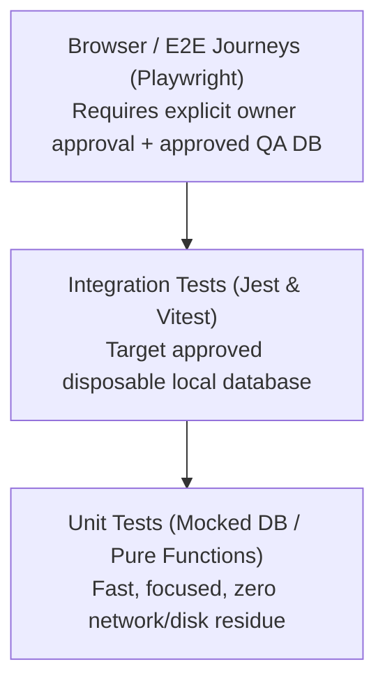

# Ryo Academy — Testing & Quality Standards

> **Context Document**  
> **Status:** Authoritative  
> **Audience:** Human Engineers and AI Agents  
> **Canonical Path:** `docs/agent-context/testing-and-quality.md`

---

## 1. Testing Philosophy & Verification Pyramid

Testing in Ryo Academy prioritizes **evidence-based correctness, regression prevention, and absolute environment safety**:



---

## 2. Strict Database & Environment Boundaries

> [!CAUTION]
> **APPROVED LOCAL QA DATABASE ONLY**
> 
> Database writes, migrations, seeds, integration tests, HTTP QA, and browser QA may use **only an approved disposable local QA database**.
> 
> - **NEVER** use Neon or any unverified remote, shared, or staging database.
> - Never execute database-backed tests without verifying the active `DATABASE_URL` targets `localhost` or an approved isolated local container.
> - Never expose credentials, passwords, tokens, connection strings, or sensitive fixture data in test source, logs, traces, or chat.

---

## 3. Fixture Hygiene & Residue Verification

1. **Deterministic & Test-Owned:**
   - Every QA fixture must use test-owned identifiers (e.g., prefix `qa-test-admission-`, `qa-school-`).
   - Fixture generation must be idempotent.
2. **Guaranteed Teardown:**
   - Integration tests creating database rows must implement teardown in `afterAll` / `afterEach` blocks or execute within rolling-back transactions.
3. **Residue Verification:**
   - After running database-backed tests, run residue verification queries to confirm no orphaned records (`Admission`, `FeePayment`, `Student`) remain in the database.

---

## 4. Browser QA & Fixture Approval Gates

1. **Owner Approval Mandate:**
   - Browser fixture provisioning, credential delivery, and residue verification require **explicit owner approval** before executing database-backed browser testing.
2. **Timetable Module Freeze:**
   - Timetable work is **strictly out of scope** until V0 browser QA for Admissions and Fees is signed off and verified.
3. **Evidence Requirement:**
   - Never claim that browser journeys, HTTP/JWT auth, tenant isolation, or rollback behavior pass without quoting direct command outputs or test runner logs.

---

## 5. Standard Test Execution Commands

### Backend Tests (`ryo-academy-be/`)
```bash
# Run unit test suites
npm run test

# Run a specific unit test file
npx jest src/admission/admission-fee-log/admission.service.spec.ts

# Run test coverage
npm run test:cov

# Run all integration test suites via disposable PostgreSQL QA harness
npm run test:integration

# Run a specific integration test file via disposable harness
npm run test:integration test/be-nd2-admission-confirmation-timeout-concurrency.integration.ts
```

### Frontend Tests (`ryo-academy-fe/`)
```bash
# Run all Vitest suites
npm run test

# Run a specific frontend test file
npx vitest run src/lib/__tests__/admissions-api.test.tsx

# Run test coverage
npm run test:coverage
```

---

## 6. Disposable PostgreSQL QA Harness V1

Integration tests against the PostgreSQL database must execute exclusively through the lifecycle-owning harness runner (`scripts/run-integration-tests.mjs`). Docker is prohibited; the harness uses native PostgreSQL 18 user-space binaries.

### Architectural Lifecycle

1. **Exclusive Lock:** Acquires `/tmp/ryo-qa-harness.lock` with PID tracking to prevent concurrent harness execution. Stale locks with dead PIDs are safely reclaimed.
2. **Port Preflight Checks:** Verifies port `55432` is not occupied. If occupied, the harness aborts without killing or connecting to the listening process. Suite `http-jwt-qa.integration.ts` also preflights port `7676`.
3. **Cluster Initialization:** Allocates an ephemeral data directory (`/tmp/ryo-qa-pg-<random>`) and runs `initdb` with UTF-8 encoding and trusted local auth.
4. **Server Startup:** Starts PostgreSQL using `pg_ctl` bound strictly to loopback `127.0.0.1:55432` with a private UNIX socket located inside the ephemeral cluster directory.
5. **Database Creation:** Creates the isolated database `ryo_qa` owned by `ryo_qa_owner`.
6. **Token Issuance:** Generates a cryptographic instance UUID, writing it to `${clusterDir}/HARNESS_INSTANCE_TOKEN` and exporting it to child process environments.
7. **Environment Allowlist Isolation:** Purges parent environment variables to strictly prevent Neon connection strings (`*.neon.tech`) from leaking into child processes. Sets `DATABASE_URL` and `DIRECT_DATABASE_URL` to `postgresql://ryo_qa_owner@127.0.0.1:55432/ryo_qa?schema=public`.
8. **Prisma Migrations:** Runs `npx prisma migrate deploy` once against `ryo_qa` before executing any test suites.
9. **Sequential Execution:** Executes test suites sequentially with streaming stdio, individual suite timers, process-group timeouts, and real-time failure reporting.
10. **Guaranteed Teardown:** Signal traps (`SIGINT`, `SIGTERM`), unhandled errors, and normal completion trigger teardown:
    - Verifies the running postmaster PID belongs to the current ephemeral data directory before issuing `pg_ctl stop`.
    - Confirms port `55432` is released.
    - Completely deletes the ephemeral directory under `/tmp`.
    - Releases `/tmp/ryo-qa-harness.lock`.

### Mandatory QA Database Guard (`assertQaDatabase`)

Every integration test suite must invoke `assertQaDatabase(db)` immediately after connecting:

```typescript
import { assertQaDatabase } from '../src/test/assert-qa-database.js';

// After db.$connect():
await assertQaDatabase(db);
```

The guard verifies:
- `DATABASE_URL` and `DIRECT_DATABASE_URL` hostname is `127.0.0.1` / `localhost`, port is `55432`, db is `/ryo_qa`, and username is `ryo_qa_owner`.
- Neither URL contains `neon.tech` or external domains.
- `QA_HARNESS_INSTANCE_TOKEN` and `QA_HARNESS_DATA_DIR` environment variables are present and match disk records.
- Live PostgreSQL identity query confirms `host(inet_server_addr())` is loopback, `inet_server_port()` is `55432`, `current_database()` is `ryo_qa`, `current_user` is `ryo_qa_owner`, and `current_setting('data_directory')` matches the harness temporary directory.

