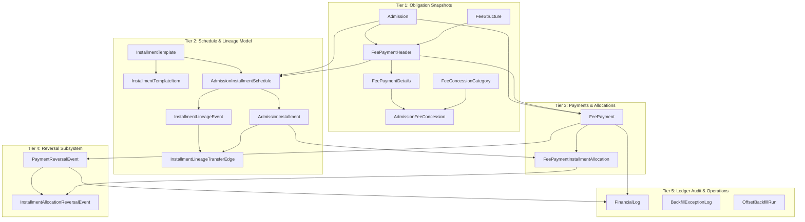
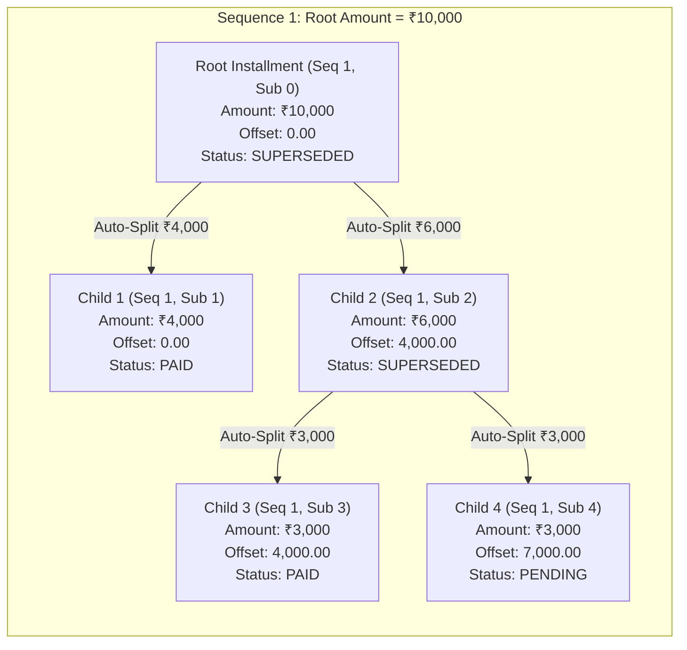

# Ryo Academy ERP — Financial Module V1 Architecture Specification

> **Canonical Architecture Document**  
> **Status:** Final / Implemented  
> **Milestones Closed:** Task 02, Task 02.1, Task 03A, Task 03B, Task 03C, Task 04B.1, Task 04B.2, Task 04B.3, Task 04B.4, Task 04B.5, Task 04B.5.2, Task 04B.5.2.2, Task 04B.5.2.3.

---

## 1. Executive Summary & Core Principles

The Ryo Academy ERP Financial Module V1 provides a ledger-grade, audit-compliant financial foundation for educational institutions. The architecture enforces strict tenant isolation, immutable historical financial lineage, deterministic mathematical conservation of all monetary values, and single-writer concurrency guarantees.

### Non-Negotiable Financial Invariants
1. **Mathematical Conservation:** At every level of the hierarchy, obligations and payments must reconcile without floating-point drift or clamping:
   $$\text{totalFeeAmount} \equiv \text{netAmount} \equiv \text{grossAmount} - \text{discountAmount}$$
   $$\text{totalDueAmount} \equiv \text{totalFeeAmount} - \text{totalPaidAmount}$$
   $$\sum_{i} \text{activePendingLeaves}_i \equiv \text{totalDueAmount}$$
   $$\sum_{j} \text{activePaidLeaves}_j \equiv \text{totalPaidAmount}$$
   $$\sum_{k} \text{rootInstallments}_k \equiv \text{schedule.totalAmount} \equiv \text{header.netAmount}$$
2. **Immutability of Financial History:** Records representing financial events (`FeePayment`, `FinancialLog`, `PaymentReversalEvent`, `InstallmentLineageEvent`, `InstallmentLineageTransferEdge`) are strictly append-only:
   - **Database-Enforced Deletion Prevention:** All relational foreign keys use `onDelete: Restrict`. Deleting any parent entity (Admission, FeePaymentHeader, FeePayment, Schedule, Installment) that has dependent financial or lineage records is physically blocked by PostgreSQL.
   - **Application-Enforced Mutation Restrictions:** Financial services (`StudentService`, `PaymentReversalService`, `AdmissionInstallmentScheduleService`) expose no update methods or API routes for modifying historical financial records. Updating is permitted exclusively on explicitly approved monotonic counters (`FeePaymentInstallmentAllocation.reversedAmount`, `FeePaymentDetails.amountPaid`, `FeePaymentHeader.totalPaidAmount`, `FeePaymentHeader.totalDueAmount`) and installment lifecycle status (`status: SUPERSEDED`, `supersededAt = now()`) inside verified database transactions. There are no PostgreSQL `BEFORE UPDATE` trigger functions on these tables; update immutability is guaranteed by the service-layer domain model.
3. **Directed Acyclic Graph (DAG) Lineage:** Installment schedules are tracked as rooted trees within sequence boundaries. Partial payments split installments into immutable settled and pending leaves connected by directional transfer edges.
4. **Exact Reversal Restoration:** Reversals restore the exact original installment obligation and monetary offset coordinate. The system never reruns FIFO allocation during a reversal.
5. **No Clamping or Silent Repair:** If any balance check, DAG structure, or interval partition invariant fails, the operation immediately aborts and rolls back atomically.

---

## 2. Financial Domain Overview & Entity Catalog

The financial module comprises 18 relational models categorized into five architectural tiers:



### 2.1 Entity Responsibilities and Classification

| Entity | Classification | Responsibilities & Invariants |
| :--- | :--- | :--- |
| **`Admission`** | Aggregate Root | Represents the student's admission lifecycle (`DRAFT`, `CONFIRMED`). Acts as row-lock target for serializing mutations. |
| **`FeeStructure`** | Catalog Master | Master definition of annual fees partitioned into academic year, program, and class. Versioned and soft-deletable. |
| **`FeePaymentHeader`** | Obligation Snapshot & Counter | Tracks total obligation (`grossAmount`, `discountAmount`, `netAmount`, `totalFeeAmount`) and running aggregates (`totalPaidAmount`, `totalDueAmount`). One per fee category (e.g., Academic, Transport). |
| **`FeePaymentDetails`** | Component Snapshot | Individual fee components (Tuition, Library, Lab) with original obligation, concession deductions, and running `amountPaid`. |
| **`FeeConcessionCategory`**| Catalog Master | Global or school-specific discount categories (Merit, Staff Ward, Sibling). Can be deactivated. |
| **`AdmissionFeeConcession`**| Concession Link | Links a component to a concession category. Allowed only in `DRAFT` admission status. Freezes snapshot upon confirmation. |
| **`InstallmentTemplate`** | Template Master | Predefined installment division rules (e.g., 50/30/20 Term split). Governed by school ownership. |
| **`InstallmentTemplateItem`**| Template Detail | Percentage and relative due date definitions belonging to an `InstallmentTemplate`. Sum of percentages must equal 100.00%. |
| **`AdmissionInstallmentSchedule`**| Schedule Aggregate Root | Binds an admission and header to an installment schedule. Implements composite unique key `(id, feePaymentHeaderId)`. |
| **`AdmissionInstallment`** | Lineage Node & Leaf | Represents an installment obligation. Contains `sequence`, physical identity `subSequence`, monetary coordinate `offsetAmount`, and lifecycle `status`. |
| **`InstallmentLineageEvent`**| Lineage Audit | Records schedule mutations (`INITIAL_SCHEDULE`, `PAYMENT_AUTO_SPLIT`, `REVERSAL_RESTORE`). Contains optional foreign key to `FeePayment`. |
| **`InstallmentLineageTransferEdge`**| Lineage Directed Edge | Directed edge $(u, v)$ recording exact transfer amount from source installment to result installment. Conserves monetary balance. |
| **`FeePayment`** | Transaction Record | Immutable payment transaction record. Requires unique `idempotencyKey` and `amount > 0`. Emitted by `StudentService`. |
| **`FeePaymentInstallmentAllocation`**| Allocation Ledger | Records exact monetary allocation from a `FeePayment` to an `AdmissionInstallment`. Contains monotonic `reversedAmount` counter. |
| **`PaymentReversalEvent`** | Reversal Transaction | Reversal event header documenting actor, reason, idempotency key, and total reversed amount. One per `FeePayment`. |
| **`InstallmentAllocationReversalEvent`**| Reversal Allocation | 1:1 reversal allocation record linking a reversal event to an allocation. Unique on `[paymentReversalEventId, allocationId]`. |
| **`FinancialLog`** | Immutable Ledger | General financial journal entry. Flow types: `INCOME` (payments), `REVERSAL` (payment reversals), `EXPENSE` (outflows). |
| **`BackfillExceptionLog`**| Diagnostic Record | Durable operational log capturing failed graph traversals, interval gaps, or validation errors during migration backfills. |
| **`OffsetBackfillRun`** | Migration Run Monitor | Tracks execution status (`RUNNING`, `COMPLETED`, `FAILED`, `INTERRUPTED`) and diagnostics of the historical offset backfill runner. |

---

## 3. Discount Engine V1

The discount engine evaluates, applies, and snapshots concessions applied to admission fee obligations.

### 3.1 Eligibility & Concession Types
- Fee components declare `discountApplicable: boolean` and `isMandatory: boolean`. Concessions apply exclusively to components where `discountApplicable = true`.
- Concessions support two calculation types:
  1. `PERCENTAGE`: Deduction calculated as a percentage of the component's `originalAmount`.
  2. `FIXED`: Flat rupee amount deducted directly from the component.

### 3.2 Calculation Precision & Decimal Rounding
All monetary calculations are performed using arbitrary-precision decimals (`Prisma.Decimal` / `decimal.js`). Fractional paise are rounded using standard arithmetic half-up rounding (`ROUND_HALF_UP`) to two decimal places independently per eligible fee component:
$$\text{discountAmount} = \text{round}\left(\text{originalAmount} \times \frac{\text{percentage}}{100}, 2, \text{ROUND\_HALF\_UP}\right)$$
> [!NOTE]
> `ROUND_HALF_UP` rounds halfway cases (e.g. 0.005) away from zero (to 0.01). It is standard symmetric arithmetic rounding, distinct from bankers' rounding (`ROUND_HALF_EVEN`), which rounds halfway cases to the nearest even digit.
- If the calculated discount exceeds `originalAmount`, it is capped at `originalAmount` ($finalAmount \ge 0$).
- Negative amounts or negative discounts are strictly prohibited by schema check constraints.

### 3.3 Lifecycle & Immutability Rules
- **Draft-Only Assignment:** Concessions can only be assigned, updated, or removed while the `Admission` has `admissionStatus = DRAFT`.
- **Confirmation Freeze:** Upon admission confirmation (`confirmAdmission`):
  1. Concession amounts are computed and permanently snapshotted into `AdmissionFeeConcession.calculatedAmount`.
  2. Component deductions are frozen into `FeePaymentDetails.discountAmount` and `FeePaymentDetails.finalAmount`.
  3. Header aggregates (`grossAmount`, `discountAmount`, `netAmount`, `totalFeeAmount`, `totalDueAmount`) are locked.
  4. Subsequent changes to `FeeConcessionCategory` (e.g., deactivation, percentage changes) do not affect existing confirmed admissions.

### 3.4 Reconciliation Equations
The discount engine guarantees the following eight reconciliation equations for every confirmed header:
1. $\text{grossAmount} \equiv \sum \text{FeePaymentDetails.originalAmount}$
2. $\text{discountAmount} \equiv \sum \text{FeePaymentDetails.discountAmount}$
3. $\text{netAmount} \equiv \text{grossAmount} - \text{discountAmount}$
4. $\text{totalFeeAmount} \equiv \text{netAmount}$
5. $\text{totalDueAmount} \equiv \text{totalFeeAmount} - \text{totalPaidAmount}$
6. $\forall d \in \text{FeePaymentDetails}: \text{finalAmount} \equiv \text{originalAmount} - \text{discountAmount}$
7. $\forall d \in \text{FeePaymentDetails}: \text{totalAmountToBePaid} \equiv \text{finalAmount}$
8. $\forall d \in \text{FeePaymentDetails}: 0 \le \text{amountPaid} \le \text{totalAmountToBePaid}$

---

## 4. Installment Management V1

Installment management handles the division of net fee obligations into temporal payments, partial split branching, and interval conservation.

### 4.1 Topology & Multiple Headers
- Installment schedules exist at the `(Admission, FeePaymentHeader)` boundary.
- If an admission possesses multiple headers (e.g., Academic Fees vs. Transport Fees), each header has an independent `AdmissionInstallmentSchedule` and distinct lineage tree.
- A composite database foreign key `fk_installment_schedule_header` ensures installments cannot reference a schedule belonging to a different header.

### 4.2 Schedule Creation & Confirmation
1. **Templates:** Sourced from `InstallmentTemplate` (e.g., standard 3-term 50/30/20 split).
2. **Custom Schedules:** Created manually by `OFFICE_ADMIN` with mandatory justification text. Total amount must reconcile exactly to `header.netAmount`.
3. **Default Single-Installment:** If no custom schedule is configured before admission confirmation, the system automatically provisions a single full-amount installment (`sequence = 1`, `dueDate = admissionDate + 30 days`).
4. **Post-Confirmation Immutability:** Once confirmed, routine manual schedule mutations are forbidden. Modifications occur solely via payments (`PAYMENT_AUTO_SPLIT`) or reversals (`REVERSAL_RESTORE`).

### 4.3 Directed Acyclic Graph (DAG) Lineage Model
Installments within each sequence are tracked as a directed tree originating from a root installment:



- **Root Convention:** Each sequence $s \in [1, \text{installmentCount}]$ has exactly one root installment where `rootInstallmentId = null` and `offsetAmount = 0.00`.
- **Node Classification:**
  - **Active Leaves:** Installments where `supersededAt = null` and `status` $\in$ `{PENDING, PAID, PAID_EARLY}`. No outgoing transfer edges exist from an active leaf.
  - **Superseded Nodes:** Historical rows where `supersededAt != null` and `status = SUPERSEDED`. All superseded nodes have outgoing transfer edges.
- **Edge Conservation:** For every split event $E$, the amount of the source installment equals the sum of the outgoing transfer edge amounts:
  $$\text{source.amount} \equiv \sum_{e \in E.\text{transferEdges}} e.\text{amount}$$

### 4.4 Mathematical Monetary Interval Partition Model
Each installment obligation is modeled as a half-open monetary interval:
$$I_i = [offset_i, offset_i + amount_i)$$
For any sequence root of obligation $R$, the active leaves partition the root obligation interval without gaps and without overlaps:
$$\bigcup_{k \in \text{activeLeaves}(s)} [offset_k, offset_k + amount_k) \equiv [0, R)$$
$$\forall j \ne k: I_j \cap I_k = \emptyset$$

---

## 5. FIFO Payment Allocation Engine

Payment processing is centralized in [`StudentService.recordStudentFeePayment`](file:///home/qwerty/Qwerty_WorkSpace/ProjWorks/Poo anna/Ryo Academy/Backend/ryo-academy-be/src/student/student.service.ts).

### 5.1 Canonical Allocation Ordering
The FIFO allocation query selects candidate active pending installments using the strict canonical coordinate:
```sql
SELECT * FROM "AdmissionInstallment"
WHERE "scheduleId" = $1 AND "status" = 'PENDING' AND "supersededAt" IS NULL
ORDER BY "dueDate" ASC, "sequence" ASC, "offsetAmount" ASC, "id" ASC
FOR UPDATE;
```

#### Why `subSequence` is NOT in the Sorting Coordinate
- `subSequence` is a monotonic integer assigned at insert time to ensure a physical unique constraint `(scheduleId, sequence, subSequence)`.
- If an earlier payment is reversed, a restored installment receives a newly allocated higher `subSequence`.
- Sorting by `subSequence` would cause restored installments to sort *after* later installments, violating FIFO.
- Sorting by `offsetAmount ASC` ensures that the restored installment $[0, \text{restoredAmount})$ immediately regains its correct mathematical priority at the front of the sequence obligation.

### 5.2 Auto-Split Execution Mechanics
When a payment partially covers an installment ($P < \text{inst.amount}$):
1. **Source Row:** Marked `status: SUPERSEDED`, `supersededAt: new Date()`.
2. **Settled Child:**
   - `amount`: $P$
   - `offsetAmount`: $inst.\text{offsetAmount}$ (inherits the source offset)
   - `status`: `PAID` or `PAID_EARLY`
   - `subSequence`: $\max(\text{subSequence}) + 1$
3. **Remaining Child:**
   - `amount`: $inst.\text{amount} - P$
   - `offsetAmount`: $inst.\text{offsetAmount} + P$ (monetary offset shifted by paid amount)
   - `status`: `PENDING`
   - `subSequence`: $\max(\text{subSequence}) + 2$
4. **Lineage Event & Edges:** An `InstallmentLineageEvent` (`PAYMENT_AUTO_SPLIT`) is created linking `feePaymentId`, with two transfer edges connecting the source to the two children.
5. **Allocation:** `FeePaymentInstallmentAllocation` is created against the settled child.

### 5.3 Payment Idempotency
- Every payment request mandates a UUID `idempotencyKey`.
- If a request is retried with an identical `(idempotencyKey, studentId, amount)` payload, the existing payment and updated fee balances are safely returned without creating duplicate payments or allocations.
- Reusing an idempotency key with conflicting parameters (different amount or student) throws `409 ConflictException`.

---

## 6. Full Payment Reversal V1

Payment reversals are governed by [`PaymentReversalService`](file:///home/qwerty/Qwerty_WorkSpace/ProjWorks/Poo anna/Ryo Academy/Backend/ryo-academy-be/src/student/payment-reversal.service.ts).

### 6.1 Business Boundaries & Authorization
- **Full Reversal Only:** V1 supports only 100% full payment reversal. Partial refunds are explicitly out of scope.
- **One Reversal per Payment:** A `FeePayment` can be reversed exactly once. Double reversals are blocked by database constraints.
- **Role-Based Access Control:** Reversals require the `FEES_REVERSE` permission, restricted exclusively to the `COLLEGE_ADMIN` role.

### 6.2 Exact Allocation Restoration
The reversal engine does not re-run FIFO allocation. It inspects the immutable `FeePaymentInstallmentAllocation` records of the target payment and restores each allocation identically:
1. Target installment is marked `status: SUPERSEDED`, `supersededAt: new Date()`.
2. Restored child installment is created:
   - `amount`: exactly equals `allocation.allocatedAmount`
   - `offsetAmount`: exactly equals target installment's `offsetAmount`
   - `dueDate`: exactly preserves target installment's original `dueDate`
   - `status`: `PENDING`
   - `subSequence`: $\max(\text{subSequence}) + 1$
3. Allocation counter `reversedAmount` is updated to equal `allocatedAmount`.
4. Lineage event `REVERSAL_RESTORE` is recorded with a 1:1 transfer edge linking the settled installment to the restored installment.

### 6.3 Deterministic Reverse-FIFO Component Counter Rollback
Component counters (`FeePaymentDetails.amountPaid`) are rolled back using aggregate reverse-FIFO order:
- Components are evaluated in reverse attribution order (`createdAt DESC, id DESC`).
- Component `amountPaid` counters are decremented until the entire reversal amount is satisfied.
- The system explicitly asserts aggregate rollback and does not claim exact historical component-level attribution.

### 6.4 In-Transaction Post-Reversal Invariant Verification
Before committing the reversal transaction, `verifyPostReversalInvariants` executes five rigorous checks inside `$transaction`:
- **Check A (Header Reconciliation):**
  - $\text{totalDueAmount} \equiv \text{totalFeeAmount} - \text{totalPaidAmount}$
  - $\text{totalFeeAmount} \equiv \text{netAmount}$
- **Check B (Installment Leaf Reconciliation):**
  - $\sum \text{active PENDING leaves} \equiv \text{header.totalDueAmount}$
  - $\sum \text{active PAID/PAID\_EARLY leaves} \equiv \text{header.totalPaidAmount}$
  - $\sum \text{ALL active leaves} \equiv \text{header.totalFeeAmount}$
  - Consistency: $\text{supersededAt} \ne \text{null} \iff \text{status} = \text{SUPERSEDED}$
- **Check C (Component Balance Reconciliation):**
  - $\sum \text{FeePaymentDetails.amountPaid} \equiv \text{header.totalPaidAmount}$
  - $\forall d \in \text{FeePaymentDetails}: 0 \le \text{amountPaid} \le \text{totalAmountToBePaid}$
- **Check D (Allocation Reversal Reconciliation):**
  - $\sum \text{InstallmentAllocationReversalEvent.amount} \equiv \text{FeePayment.amount}$
  - $\forall a \in \text{allocations}: a.\text{reversedAmount} \equiv a.\text{allocatedAmount}$
- **Check E (Schedule Obligation Reconciliation):**
  - $\sum \text{root installments} \equiv \text{schedule.totalAmount} \equiv \text{header.netAmount}$

If any invariant check fails, the entire transaction aborts and rolls back with zero residue.

---

## 7. Concurrency, Locking & Database Constraints

### 7.1 Lock Hierarchy
To prevent deadlocks under high concurrency, all transactions acquire locks in strict topological order across every financial writer:

```text
School (Tenant Boundary)
  └── Admission (SELECT FOR UPDATE)
        └── FeePaymentHeader (SELECT FOR UPDATE)
              └── FeePaymentDetails (ORDER BY id ASC FOR UPDATE)
                    └── AdmissionInstallmentSchedule (SELECT FOR UPDATE)
                          └── AdmissionInstallment (Candidate rows ORDER BY id ASC FOR UPDATE)
                                └── FeePayment (SELECT FOR UPDATE)
                                      └── FeePaymentInstallmentAllocation (ORDER BY id ASC FOR UPDATE)
```

#### Lock Sequences by Financial Operation
- **Payment Processing (`StudentService.recordStudentFeePayment`):**
  1. `Admission` (`SELECT id, "admissionStatus", "schoolId" FROM "Admission" WHERE id = $1 FOR UPDATE`)
  2. `FeePaymentHeader` (`SELECT id FROM "FeePaymentHeader" WHERE id = $1 FOR UPDATE`)
  3. `AdmissionInstallmentSchedule` (`SELECT id FROM "AdmissionInstallmentSchedule" WHERE "feePaymentHeaderId" = $1 FOR UPDATE`)
  4. `AdmissionInstallment` candidate leaves (`SELECT * FROM "AdmissionInstallment" WHERE ... ORDER BY "dueDate" ASC, "sequence" ASC, "offsetAmount" ASC, "id" ASC FOR UPDATE`)
- **Payment Reversal (`PaymentReversalService.reverseStudentFeePayment`):**
  1. `Admission` (`SELECT id, "admissionStatus", "schoolId" FROM "Admission" WHERE id = $1 FOR UPDATE`)
  2. `FeePaymentHeader` (`SELECT id FROM "FeePaymentHeader" WHERE id = $1 FOR UPDATE`)
  3. `FeePaymentDetails` (`SELECT id FROM "FeePaymentDetails" WHERE "feePaymentHeaderId" = $1 ORDER BY id ASC FOR UPDATE`)
  4. `AdmissionInstallmentSchedule` (`SELECT id FROM "AdmissionInstallmentSchedule" WHERE "feePaymentHeaderId" = $1 FOR UPDATE`)
  5. `AdmissionInstallment` (`SELECT id, ... FROM "AdmissionInstallment" WHERE id IN (...) ORDER BY id ASC FOR UPDATE`)
  6. `FeePayment` (`SELECT id FROM "FeePayment" WHERE id = $1 FOR UPDATE`)
  7. `FeePaymentInstallmentAllocation` (`SELECT id, ... FROM "FeePaymentInstallmentAllocation" WHERE "feePaymentId" = $1 ORDER BY id ASC FOR UPDATE`)
- **Admission Confirmation (`AdmissionService.confirmAdmission`):**
  1. `Admission` (`SELECT id FROM "Admission" WHERE id = $1 FOR UPDATE`)
  2. `FeePaymentHeader` (`SELECT id FROM "FeePaymentHeader" WHERE "admissionId" = $1 AND "isActive" = true ORDER BY id ASC FOR UPDATE`)
- **Draft Schedule Mutation (`AdmissionInstallmentScheduleService.updateDraftSchedule`):**
  1. `Admission` (`SELECT id FROM "Admission" WHERE id = $1 FOR UPDATE`)
  2. `FeePaymentHeader` (`SELECT id FROM "FeePaymentHeader" WHERE id = $1 FOR UPDATE`)
  3. `AdmissionInstallmentSchedule` (`SELECT id FROM "AdmissionInstallmentSchedule" WHERE id = $1 FOR UPDATE`)
  4. `AdmissionInstallment` (`SELECT id FROM "AdmissionInstallment" WHERE "scheduleId" = $1 ORDER BY sequence ASC, "subSequence" ASC FOR UPDATE`)

### 7.2 Database-Enforced Constraints
Relational integrity is guarded by physical PostgreSQL constraints:

| Table | Constraint Name | Type | Physical SQL Definition |
| :--- | :--- | :--- | :--- |
| `AdmissionInstallment` | `AdmissionInstallment_offsetAmount_not_null` | NOT NULL | `NOT NULL "offsetAmount"` (no default) |
| `AdmissionInstallment` | `chk_installment_non_negative_offset` | CHECK | `CHECK ("offsetAmount" >= 0)` |
| `AdmissionInstallment` | `chk_installment_positive_amount` | CHECK | `CHECK (amount > 0)` |
| `AdmissionInstallment` | `fk_installment_schedule_header` | Composite FK | `FOREIGN KEY ("scheduleId", "feePaymentHeaderId") REFERENCES "AdmissionInstallmentSchedule"(id, "feePaymentHeaderId") ON DELETE RESTRICT` |
| `FeePaymentInstallmentAllocation` | `chk_alloc_non_negative_reversed_amount`| CHECK | `CHECK ("reversedAmount" >= 0)` |
| `FeePaymentInstallmentAllocation` | `chk_alloc_reversed_lte_allocated` | CHECK | `CHECK ("reversedAmount" <= "allocatedAmount")` |
| `FeePaymentInstallmentAllocation` | `fk_alloc_payment_header` | Composite FK | `FOREIGN KEY ("feePaymentId", "feePaymentHeaderId") REFERENCES "FeePayment"(id, "feePaymentHeaderId") ON DELETE RESTRICT` |
| `InstallmentAllocationReversalEvent` | `InstallmentAllocationReversalEvent_reversalEventId_allocId_key` | UNIQUE | `UNIQUE ("paymentReversalEventId", "allocationId")` |
| `FeePaymentDetails` | `chk_fee_payment_details_non_negative_amount_paid` | CHECK | `CHECK ("amountPaid" >= 0)` |
| `PaymentReversalEvent` | `PaymentReversalEvent_feePaymentId_key` | UNIQUE | `UNIQUE ("feePaymentId")` |
| `PaymentReversalEvent` | `chk_payment_reversal_positive_amount` | CHECK | `CHECK ("reversalAmount" > 0)` |

---

## 8. API Endpoints & Permissions Matrix

All financial endpoints require authenticated session tokens (`JwtAuthGuard`) and tenant scope resolution.

| Method | Endpoint | Controller | Permission Required | Authorized Roles | Description |
| :--- | :--- | :--- | :--- | :--- | :--- |
| `POST` | `/students/:studentId/fee-payments` | `StudentController` | `FEES_CREATE` | `COLLEGE_ADMIN`, `OFFICE_ADMIN` | Record student fee payment against active installment schedule via FIFO |
| `POST` | `/students/:studentId/fee-payments/:paymentId/reversals` | `StudentController` | `FEES_REVERSE` | `COLLEGE_ADMIN` only | Reverse completed fee payment, restore original installments and reverse component counters |
| `GET` | `/students/:studentId/fees` | `StudentController` | `FEES_READ` | `COLLEGE_ADMIN`, `OFFICE_ADMIN`, `STUDENT` | Query student fee obligation, payments, and active installment schedule status |
| `POST` | `/admissions/:id/installment-schedule` | `AdmissionInstallmentScheduleController` | `INSTALLMENT_SCHEDULE_MANAGE` | `OFFICE_ADMIN` | Create initial draft installment schedule for unconfirmed admission |
| `PUT` | `/admissions/:id/installment-schedule` | `AdmissionInstallmentScheduleController` | `INSTALLMENT_SCHEDULE_MANAGE` | `OFFICE_ADMIN` | Update draft installment schedule (amounts, due dates, sequences) |
| `GET` | `/admissions/:id/installment-schedule` | `AdmissionInstallmentScheduleController` | `INSTALLMENT_SCHEDULE_READ` | `COLLEGE_ADMIN`, `OFFICE_ADMIN` | Read admission installment schedule and active leaves |
| `POST` | `/installment-templates` | `InstallmentTemplateController` | `INSTALLMENT_TEMPLATE_CREATE` | `COLLEGE_ADMIN`, `OFFICE_ADMIN` | Create school installment template (items summing to 100%) |
| `PATCH`| `/installment-templates/:id/deactivate` | `InstallmentTemplateController` | `INSTALLMENT_TEMPLATE_DEACTIVATE` | `COLLEGE_ADMIN` | Deactivate installment template for future admissions |
| `GET` | `/installment-templates` | `InstallmentTemplateController` | `INSTALLMENT_TEMPLATE_READ` | `COLLEGE_ADMIN`, `OFFICE_ADMIN` | List active installment templates for the school |
| `POST` | `/fee-concessions` | `FeeConcessionCategoryController` | `FEES_CREATE` | `COLLEGE_ADMIN`, `OFFICE_ADMIN` | Create fee concession category |
| `GET` | `/fee-concessions` | `FeeConcessionCategoryController` | `FEES_READ` | `COLLEGE_ADMIN`, `OFFICE_ADMIN` | List fee concession categories |
| `POST` | `/admissions/:admissionId/confirm` | `AdmissionController` | `ADMISSION_UPDATE` | `COLLEGE_ADMIN`, `OFFICE_ADMIN` | Confirm admission, freeze concessions, and generate finalized installment schedule |

