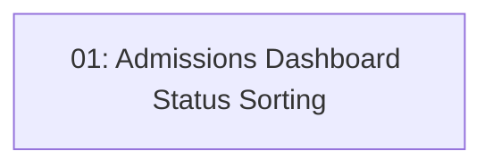

# Admissions Dashboard Status Sorting

## Resume here

- **Stage:** implemented, awaiting review
- **Next:** code review and sign-off
- **Open questions:** none
- **Last commit:** df33a2a82796f25a6a76f212e1009ce87bdc384b
- **Areas:** frontend, admissions, ui

## Overview

Adds deterministic operational sorting to the existing Admissions Dashboard (`AdmissionList` at `/admissions`). Admissions are ordered by lifecycle status (Confirmed $\rightarrow$ Pending $\rightarrow$ Cancelled) and chronologically within each status group (newest first by `createdAt DESC`). Implemented entirely on the frontend without changing backend contracts or financial invariants.

## Quick Links

- [Full Feature Specification](./spec.md) — complete 12-section technical specification
- [Requirements](./requirements.md) — requirements matrix and acceptance criteria R1–R6
- [Task 01](./tasks/task-01-admissions-status-sorting.md) — self-contained implementation task

## Dependency Graph

## Batches

| Batch | Tasks | Tiers | Description |
|---|---|---|---|
| 1 | task-01-admissions-status-sorting.md | light | Implement pure comparator in `admissions-api.ts`, integrate with `AdmissionList` in `admissions-students-pages.tsx`, and add unit/component tests |

**Model plan:** 1 light · 0 standard · 0 deep.

## Task Status

### Batch 1
- [x] [task-01-admissions-status-sorting](./tasks/task-01-admissions-status-sorting.md) — Implement pure comparator, integrate in AdmissionList, and add tests
