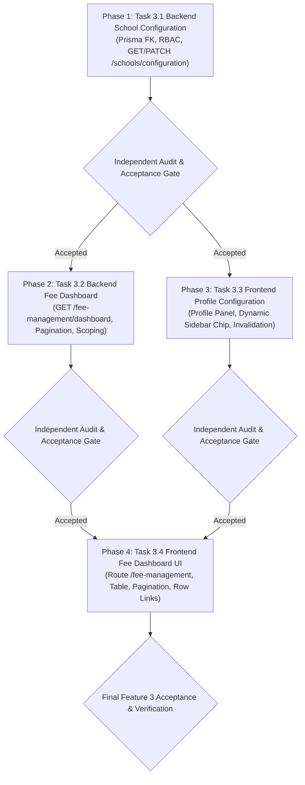

# Feature 3: School-wide Academic Year Configuration & Fee Management Dashboard (V1.1)

## Resume here

- **Stage:** Phase 4 (Task 3.4) implemented & verified; DATA-MIN-01 resolved, awaiting independent code review
- **Next:** independent code review of Task 3.4 and Feature 3 final sign-off
- **Open questions:** none (Task 3.4 verification complete)
- **Last commit:** `df33a2a82796f25a6a76f212e1009ce87bdc384b`
- **Areas:** backend, frontend, database, rbac, admissions, fees

---

## Overview

Feature 3 delivers two tightly coupled operational capabilities for Ryo Academy:
1. **School-wide Academic Year Configuration**: Allows the College Administrator to configure the school's operational academic year via the `/profile` page. Persisted through a dedicated School-level column (`activeAcademicYearId`) with bi-directional foreign-key disambiguation in Prisma.
2. **Fee Management Dashboard (`/fee-management`)**: A dedicated dashboard presenting confirmed admissions scoped to the school's configured academic year, while strictly preserving the existing `/fees` route as the Fee Structure Master.

The entire implementation enforces strict tenant isolation (relying on server-authenticated JWT context), lifecycle independence (configuration never mutates AcademicYear lifecycle state), and financial immutability (zero financial mutations).

---

## Quick Links

- [Full Technical Specification](./spec.md) — complete 11-section technical and architectural specification (V1.1)
- [Requirements Matrix & Acceptance Criteria](./requirements.md) — requirements R1–R18 and test criteria
- [Task 3.1: School Configuration Backend](./tasks/task-3.1-school-configuration-backend.md) — Prisma schema, RBAC seeds, `GET/PATCH /schools/configuration`
- [Task 3.2: Fee Dashboard Backend](./tasks/task-3.2-fee-dashboard-backend.md) — `GET /fee-management/dashboard` with pagination and scoping
- [Task 3.3: Profile Configuration UI](./tasks/task-3.3-profile-configuration-ui.md) — `/profile` College Admin settings and dynamic sidebar chip
- [Task 3.4: Fee Dashboard UI Screen](./tasks/task-3.4-fee-dashboard-ui.md) — `/fee-management` dashboard screen and table row links

---

## Refined 4-Phase Dependency Pipeline

Execution is strictly decoupled into 4 sequential phases with explicit review and acceptance gates between phases:

---

## Task Sequence, Deliverables & Stop Conditions

| Phase | Task File | Dependencies | Deliverables | Stop Condition |
|---|---|---|---|---|
| **Phase 1** | [task-3.1-school-configuration-backend.md](./tasks/task-3.1-school-configuration-backend.md) | None | Schema relation disambiguation, `activeAcademicYearId` FK, `SCHOOL_UPDATE` constant/seed, `GET/PATCH /schools/configuration`, unit tests | Unit tests pass, typecheck clean. **Submit for review & STOP.** |
| **Phase 2** | [task-3.2-fee-dashboard-backend.md](./tasks/task-3.2-fee-dashboard-backend.md) | **Task 3.1 Accepted** | `GET /fee-management/dashboard`, pagination, DB query scoping, unconfigured empty state, unit tests | Unit tests pass, typecheck clean. **Submit for review & STOP.** |
| **Phase 3** | [task-3.3-profile-configuration-ui.md](./tasks/task-3.3-profile-configuration-ui.md) | **Task 3.1 Accepted** | `schools-api.ts`, shared `useSchoolConfiguration()` hook, Profile card, dynamic sidebar chip, component tests | Component tests pass, typecheck clean. **Submit for review & STOP.** |
| **Phase 4** | [task-3.4-fee-dashboard-ui.md](./tasks/task-3.4-fee-dashboard-ui.md) | **Task 3.2 & 3.3 Accepted** | `fee-dashboard-api.ts`, `/fee-management` route, admission row links to `/admissions/:id`, component tests | Component tests pass, build clean. **Submit for sign-off.** |

---

## Task Status Checklist

- [x] [Task 3.1: School Configuration Backend](./tasks/task-3.1-school-configuration-backend.md) — *Implemented, verified, and audited*
- [x] [Task 3.2: Fee Dashboard Backend](./tasks/task-3.2-fee-dashboard-backend.md) — *Implemented, audited, and accepted*
- [x] [Task 3.3: Profile Configuration UI](./tasks/task-3.3-profile-configuration-ui.md) — *Implemented, audited, and accepted*
- [x] [Task 3.4: Fee Dashboard UI Screen](./tasks/task-3.4-fee-dashboard-ui.md) — *Implemented & verified; DATA-MIN-01 resolved (Awaiting review)*
