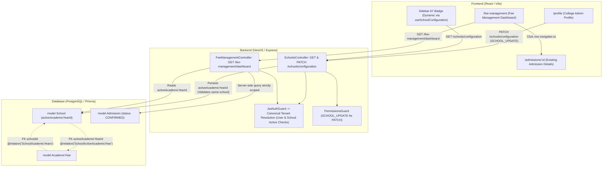
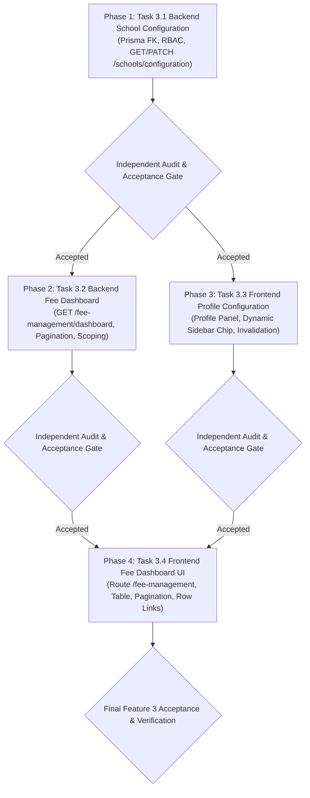

# Technical Specification: School-wide Academic Year Configuration & Fee Management Dashboard (V1.1)

## 1. Executive Summary & Architecture Overview

This specification details the architecture, data models, REST endpoints, UI screens, and security contracts for **Feature 3**:
1. **School-wide Academic Year Configuration**: Allows the College Administrator to configure the school's operational academic year via the `/profile` page, persisted directly onto the `School` entity.
2. **Fee Management Dashboard (`/fee-management`)**: A dedicated dashboard providing visibility into confirmed admissions belonging to the school's configured academic year, while preserving the existing `/fees` route as the Fee Structure Master.



---

## 2. Approved Decisions Baseline

The following decisions were approved during architecture review and form the immutable constraints for this feature:

1. **School-level Persistence**: Persist the configured academic year through a School-level column `activeAcademicYearId` with a proper database foreign key relationship to `AcademicYear`.
2. **Prisma Bi-directional Disambiguation**: The relationship must be correctly modeled on both sides in Prisma with explicit relation names to resolve ambiguity with the existing `academicYears` collection.
3. **Dedicated Configuration Endpoints**: Create `GET /schools/configuration` and `PATCH /schools/configuration`.
4. **Dedicated Dashboard Endpoint**: Create `GET /fee-management/dashboard`.
5. **Canonical Tenant Resolution**: Derive school identity strictly from authenticated server-side user context (`req.user.userId -> user.schoolId`). Verify user and school active/non-deleted state. Never trust client-supplied `schoolId`.
6. **Narrow RBAC Permission**: Introduce `PERMISSIONS.SCHOOL_UPDATE = 'school:update'` and assign it to `COLLEGE_ADMIN`.
7. **Separate Dashboard Route**: Create a separate `/fee-management` dashboard route and preserve `/fees` as Fee Structure Master.
8. **No Automatic Fallbacks**: Do not automatically select the newest Academic Year when no school configuration exists.
9. **Lifecycle Independence**: The configured year is an operational dashboard selection; selecting it must never activate, close, or mutate `AcademicYear` lifecycle state.
10. **Confirmed Admissions Only**: The dashboard displays admissions with `admissionStatus: CONFIRMED` only (`DRAFT` and `CANCELLED` are strictly excluded).
11. **Server-Side Scoping**: Dashboard results must be server-scoped in the database query by authenticated user's school, configured academic year, active status, and non-deleted state. No cross-school rows may be fetched into application memory.
12. **Existing Detail Navigation**: Dashboard row clicks navigate to the existing Admission Details page (`/admissions/:id`).
13. **Financial Immutability**: The dashboard is strictly read-only. No payment creation, ledger mutations, or financial calculations are introduced.
14. **Single Frontend Source of Truth**: All UI components (Sidebar chip, Profile configuration card, Fee Dashboard context) consume the exact same `useSchoolConfiguration()` React Query hook without hardcoded strings.
15. **Strict 4-Phase Task Sequence**: Tasks are decoupled into strictly sequential verification gates (3.1 $\rightarrow$ 3.2 $\rightarrow$ 3.3 $\rightarrow$ 3.4).

---

## 3. Database & Prisma Schema Analysis

### 3.1 Existing Baseline
Currently in [school.prisma](file:///home/qwerty/Qwerty_WorkSpace/ProjWorks/Poo%20anna/Ryo%20Academy/Backend/ryo-academy-be/prisma/models/academic/school.prisma):
```prisma
model School {
  id         String   @id @default(uuid())
  name       String
  schoolCode String   @unique
  createdAt  DateTime @default(now())
  updatedAt  DateTime @updatedAt

  academicYears AcademicYear[] // Unnamed relation
  ...
}
```
Currently in [academic-year.prisma](file:///home/qwerty/Qwerty_WorkSpace/ProjWorks/Poo%20anna/Ryo%20Academy/Backend/ryo-academy-be/prisma/models/academic/academic-year.prisma):
```prisma
model AcademicYear {
  id               String   @id @default(uuid())
  name             String
  startDate        DateTime
  endDate          DateTime
  schoolId         String?
  school           School?  @relation(fields: [schoolId], references: [id])
  ...
}
```

### 3.2 Relation Disambiguation & Relation Names
In Prisma, when two distinct relations exist between the exact same two models, Prisma requires both sides of **both** relations to specify an explicit relation name. If a relation name is omitted, `prisma generate` fails with:
```
Error: Ambiguous relation between School and AcademicYear. Please provide a relation name on both sides.
```

To resolve this ambiguity, the relations must be explicitly named:
1. **Relation 1 (`SchoolAcademicYears`)**: A 1-to-many relationship where a `School` owns many `AcademicYear` records.
2. **Relation 2 (`SchoolActiveAcademicYear`)**: A 1-to-many relationship from the perspective of AcademicYear, where a `School` points to its currently active `AcademicYear`.

### 3.3 Investigation: Composite Foreign Key vs Single Foreign Key

We evaluated whether a composite foreign key on `School` referencing `AcademicYear(id, schoolId)` is feasible to enforce same-school consistency at the database schema level.

#### Findings on Composite Foreign Key:
1. **Primary Key Nullability Conflict**:
   In `School`, `id` is the primary key (`@id`) and cannot be null. If a composite FK `(activeAcademicYearId, id)` were defined referencing `AcademicYear(id, schoolId)` with `ON DELETE SET NULL`, PostgreSQL would attempt to set both columns (`activeAcademicYearId` AND `id`) to NULL on deletion of an academic year. Setting `School.id` to NULL fails with:
   `ERROR: null value in column "id" of relation "School" violates not-null constraint`.
2. **Prisma Incompatibility**:
   Prisma does not support setting only a subset of columns in a composite foreign key to NULL.
   Prisma also does not permit declaring a model's own `@id` as part of a foreign key relation fields list pointing to a child entity.
3. **Index Overhead**:
   `AcademicYear` would require an artificial `@@unique([id, schoolId])` index, duplicating the primary key index.

#### Architectural Recommendation:
The simplest, most robust, and standard relational design is:
- **Database Schema**: A single nullable foreign key column `School.activeAcademicYearId` referencing `AcademicYear(id)` with `onDelete: SetNull`.
- **Same-School Invariant Enforcement**: Enforced strictly at the **application service layer** in `SchoolsService.updateConfiguration`:
  ```typescript
  if (academicYear.schoolId !== schoolId) {
    throw new BadRequestException('Academic year does not belong to this school');
  }
  ```
- **Soft-Delete Invariant Enforcement**:
  ```typescript
  if (academicYear.deletedAt !== null || !academicYear.isActive) {
    throw new BadRequestException('Cannot configure a soft-deleted or inactive academic year');
  }
  ```

### 3.4 Proposed Prisma Schema Modifications

#### In `ryo-academy-be/prisma/models/academic/school.prisma`:
```prisma
model School {
  id         String   @id @default(uuid())
  name       String
  schoolCode String   @unique
  createdAt  DateTime @default(now())
  updatedAt  DateTime @updatedAt

  // 1. Existing relation disambiguated with explicit name
  academicYears AcademicYear[] @relation("SchoolAcademicYears")

  // 2. New configured active academic year pointer
  activeAcademicYearId String?
  activeAcademicYear   AcademicYear? @relation("SchoolActiveAcademicYear", fields: [activeAcademicYearId], references: [id], onDelete: SetNull)

  users        User[]
  admission    Admission[]
  isActive     Boolean @default(true)
  ...
  @@index([activeAcademicYearId])
}
```

#### In `ryo-academy-be/prisma/models/academic/academic-year.prisma`:
```prisma
model AcademicYear {
  id        String   @id @default(uuid())
  name      String
  startDate DateTime
  endDate   DateTime

  // 1. Existing relation disambiguated with explicit name
  schoolId         String?
  school           School?  @relation("SchoolAcademicYears", fields: [schoolId], references: [id])
  legacySchoolCode String?  @map("schoolCode")

  // 2. Reciprocal relation for active academic year pointer
  configuredInSchools School[] @relation("SchoolActiveAcademicYear")
  ...
}
```

### 3.5 Migration Ordering & Data Compatibility
1. `activeAcademicYearId` is declared optional (`String?`).
2. Existing rows in the `School` table will default to `NULL`, maintaining 100% backward compatibility without requiring data backfills during migration.
3. If an AcademicYear is hard-deleted, `onDelete: SetNull` resets `activeAcademicYearId` to `NULL`.
4. If an AcademicYear is soft-deleted, foreign key constraints remain intact; application services detect `academicYear.deletedAt !== null` and treat the configuration as unconfigured/invalid.

---

## 4. RBAC Seed Integrity & Permission Design

### 4.1 RBAC Seed Investigation
In [rbac.seed.ts](file:///home/qwerty/Qwerty_WorkSpace/ProjWorks/Poo%20anna/Ryo%20Academy/Backend/ryo-academy-be/src/database/seed/rbac.seed.ts#L91):
```typescript
const ROLE_PERMISSIONS = {
  [ROLES.COLLEGE_ADMIN]: Object.values(PERMISSIONS).filter(
    (p) => p !== PERMISSIONS.INSTALLMENT_SCHEDULE_MANAGE,
  ),
  [ROLES.OFFICE_ADMIN]: [ ... ],
  [ROLES.STAFF]: [ ... ],
};
```

#### Audit Finding:
Because `ROLE_PERMISSIONS[ROLES.COLLEGE_ADMIN]` uses `Object.values(PERMISSIONS).filter(...)`, simply adding `SCHOOL_UPDATE` to `PERMISSIONS` will automatically grant it to `COLLEGE_ADMIN`.
- This auto-grant is **intentional and approved** for `COLLEGE_ADMIN` (Approved Decision 6).
- However, for `OFFICE_ADMIN` and `STAFF`, permissions are explicitly whitelisted arrays. They will **not** receive `SCHOOL_UPDATE`.
- This ensures the narrowest safe addition without granting unwanted administrative privileges to office administrators or staff.

### 4.2 Exact RBAC Seed Specification
In `ryo-academy-be/src/auth/permissions/permission.constants.ts`:
```typescript
export const PERMISSIONS = {
  ...
  SCHOOL_UPDATE: 'school:update',
} as const;
```

In `ryo-academy-be/src/database/seed/rbac.seed.ts`:
```typescript
const PERMISSION_DESCRIPTIONS: Record<(typeof PERMISSIONS)[keyof typeof PERMISSIONS], string> = {
  ...
  [PERMISSIONS.SCHOOL_UPDATE]: 'Configure school-wide settings including active academic year.',
};
```

---

## 5. Authentication & Canonical Tenant Resolution

### 5.1 Authentication Flow
1. Client sends JWT via `Authorization: Bearer <token>`.
2. `JwtAuthGuard` validates the token and attaches `{ userId: string }` to the request object.
3. `@CurrentUser()` delivers `AuthenticatedUser { userId: string }` to controller handlers.

### 5.2 Canonical Tenant Resolution Helper
To prevent duplicate authorization code, services implement a canonical resolution helper:
```typescript
private async resolveActiveSchool(actorUserId: string): Promise<string> {
  const actor = await this.db.user.findUnique({
    where: { id: actorUserId },
    select: { id: true, schoolId: true, isActive: true, deletedAt: true },
  });

  if (!actor || !actor.isActive || actor.deletedAt !== null) {
    throw new ForbiddenException('User is inactive or deleted');
  }

  if (!actor.schoolId) {
    throw new ForbiddenException('A school-scoped user is required');
  }

  const school = await this.db.school.findUnique({
    where: { id: actor.schoolId },
    select: { id: true, isActive: true },
  });

  if (!school || !school.isActive) {
    throw new ForbiddenException('School is inactive or not found');
  }

  return school.id;
}
```

### 5.3 Rejection of Client-Supplied Identifiers
- Controllers **never** inspect client headers, route parameters, or query payloads for `schoolId`.
- DTOs enforce `forbidNonWhitelisted: true`. Any client attempt to inject `schoolId` in a payload is rejected with `400 Bad Request`.

---

## 6. Dashboard Query & Pagination Contract

### 6.1 Strict Database-Level Scoping
Cross-school records must **never** be retrieved and filtered in application memory. The Prisma query must enforce scoping directly in the `where` clause:

```typescript
const where: Prisma.AdmissionWhereInput = {
  schoolId: actorSchoolId,
  academicYearId: school.activeAcademicYearId,
  admissionStatus: AdmissionStatus.CONFIRMED,
  isActive: true,
  deletedAt: null,
  ...(query.search && {
    OR: [
      { studentName: { contains: query.search, mode: 'insensitive' } },
      { admissionNumber: { contains: query.search, mode: 'insensitive' } },
      { student: { studentName: { contains: query.search, mode: 'insensitive' } } },
    ],
  }),
  ...(query.classId && { classId: query.classId }),
  ...(query.programId && { programId: query.programId }),
};
```

### 6.2 Pagination & Deterministic Sorting
- **Page Clamping**: `page >= 1` (default 1).
- **PageSize Clamping**: `1 <= pageSize <= 100` (default 25).
- **Offset Calculation**: `skip = (page - 1) * pageSize`.
- **Deterministic Sort**: `orderBy: [{ createdAt: 'desc' }, { id: 'asc' }]`.
- **Total Count Invariant**: `count({ where })` executes with the exact same `where` object as `findMany({ where })`.

### 6.3 Empty and Invalid Configuration Behavior
1. **Unconfigured (`activeAcademicYearId === null`)**:
   - Returns `{ configured: false, invalidConfiguration: false, activeAcademicYear: null, data: [], page, pageSize, total: 0, totalPages: 0 }`.
   - Zero database queries against `Admission`.
2. **Invalid Configuration (`activeAcademicYear.deletedAt !== null || !activeAcademicYear.isActive`)**:
   - Returns `{ configured: false, invalidConfiguration: true, activeAcademicYear: null, data: [], page, pageSize, total: 0, totalPages: 0 }`.
   - Dashboard UI surfaces an alert: *"The configured academic year has been deactivated or removed. Please reconfigure."*

---

## 7. Shared Sidebar & Profile Configuration Design

### 7.1 Single Source of Truth
The frontend MUST consume a single shared React Query hook for all school configuration state:
- **Hook**: `useSchoolConfiguration()`
- **Query Key**: `['schools', 'configuration']`
- **Adapter**: `ryo-academy-fe/src/lib/schools-api.ts`

```typescript
export interface SchoolConfigurationResponse {
  schoolId: string;
  schoolName: string;
  schoolCode: string;
  activeAcademicYearId: string | null;
  activeAcademicYear: {
    id: string;
    name: string;
    startDate: string;
    endDate: string;
    isActive: boolean;
  } | null;
  isConfigured: boolean;
  isInvalid?: boolean;
}
```

### 7.2 UI State Machine for Sidebar Chip (`Shell` in `app-pages.tsx`)

| State | Condition | Display Text | Visual Indicator |
|---|---|---|---|
| **Loading** | `isLoading === true` | `"Loading AY..."` | Pulse indicator |
| **Configured** | `isConfigured === true && activeAcademicYear` | `{activeAcademicYear.name}` | Green dot (`live-dot`) |
| **Unconfigured** | `isConfigured === false && !isInvalid` | `"No AY Selected"` | Amber dot (`live-dot-amber`) |
| **Invalid** | `isInvalid === true` | `"Invalid AY"` | Red dot (`live-dot-red`) |
| **Error** | `isError === true` | `"AY Unavailable"` | Red dot (`live-dot-red`) |

**Rule:** No hardcoded `"AY 2025–26"` fallback anywhere.

### 7.3 Cache Synchronization
When the College Admin clicks "Save Configuration" on `/profile`:
1. `useUpdateSchoolConfiguration()` fires `PATCH /schools/configuration`.
2. On success, it calls:
   ```typescript
   queryClient.invalidateQueries({ queryKey: ['schools', 'configuration'] });
   queryClient.invalidateQueries({ queryKey: ['fee-management', 'dashboard'] });
   ```
3. The sidebar chip, the Profile configuration card, and the Fee Management Dashboard update immediately and synchronously.

---

## 8. Strict 4-Phase Dependency Pipeline



### Phase & Gate Definitions
1. **Phase 1: Task 3.1 (School Configuration Backend)**
   - Delivers: Schema relation naming, `activeAcademicYearId` FK, `SCHOOL_UPDATE` constant/seed, `GET/PATCH /schools/configuration`.
   - Stop condition: Unit tests pass (`schools.service.spec.ts`), typecheck passes. **Submit for review and STOP.**
2. **Phase 2: Task 3.2 (Fee Dashboard Backend)**
   - Starts ONLY after Phase 1 human acceptance.
   - Delivers: `GET /fee-management/dashboard` with pagination and confirmed admission scoping.
   - Stop condition: Unit tests pass (`fee-management.service.spec.ts`). **Submit for review and STOP.**
3. **Phase 3: Task 3.3 (Profile Configuration UI)**
   - Starts after Phase 1 acceptance.
   - Delivers: `schools-api.ts`, `/profile` configuration panel, dynamic sidebar chip.
   - Stop condition: Component tests pass, typecheck clean. **Submit for review and STOP.**
4. **Phase 4: Task 3.4 (Fee Dashboard UI Screen)**
   - Starts after Phase 2 and Phase 3 acceptance.
   - Delivers: `/fee-management` screen, pagination controls, table row links to `/admissions/:id`.
   - Stop condition: Component tests pass, typecheck clean, production build clean. **Submit for sign-off.**
